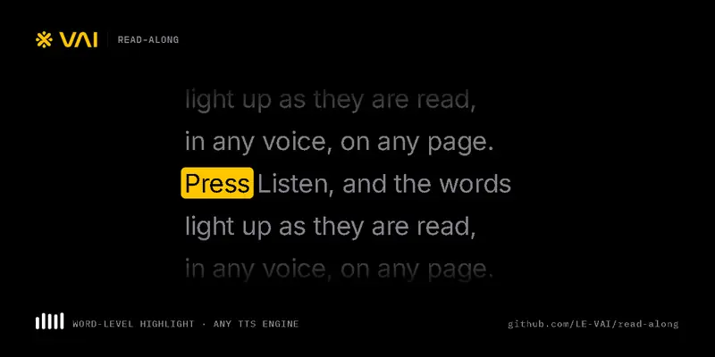
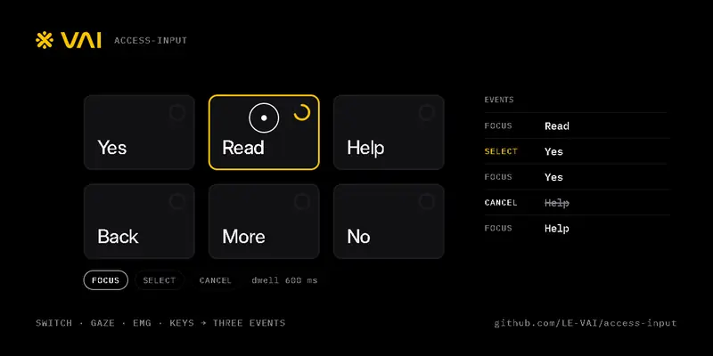
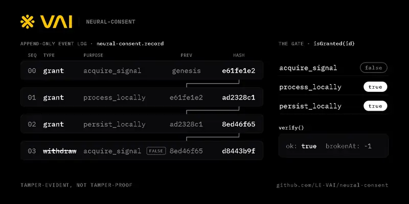
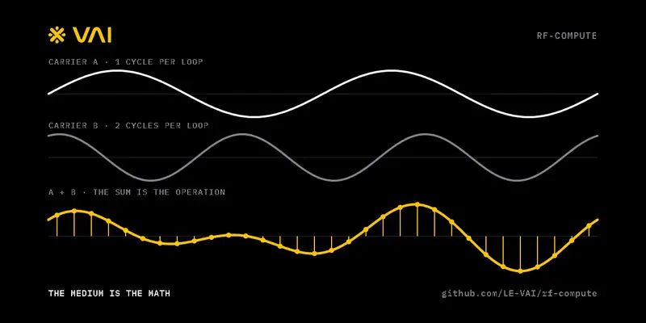

<picture>
  <source media="(prefers-color-scheme: dark)" srcset="assets/banner-dark.svg">
  <source media="(prefers-color-scheme: light)" srcset="assets/banner-light.svg">
  
</picture>

Tools for people who drive a computer with a switch, their gaze or a single muscle, and for the teams whose interfaces have to hold up. Every animation below is the real software, captured frame by frame.

 

PRODUCT

### [designesy](https://github.com/LE-VAI/designesy-org)

<a href="https://www.designesy.org"><picture>
  <source media="(prefers-reduced-motion: reduce)" srcset="assets/loops/designesy.png">
  
</picture></a>

Scores any URL against a published design contract: one grade, every check named, evidence you can cite. An MCP server, a GitHub Action, a stylelint plugin and a CLI. 
[Repository](https://github.com/LE-VAI/designesy-org) · [www.designesy.org](https://www.designesy.org)

 

ACCESSIBILITY

### [read-along](https://github.com/LE-VAI/read-along)

<a href="https://github.com/LE-VAI/read-along"><picture>
  <source media="(prefers-reduced-motion: reduce)" srcset="assets/loops/read-along.png">
  
</picture></a>

Words light up as they are spoken. An embeddable web component for bimodal reading, with pluggable speech engines and zero dependencies. 
[Repository](https://github.com/LE-VAI/read-along)

 

ACCESSIBILITY

### [access-input](https://github.com/LE-VAI/access-input)

<a href="https://github.com/LE-VAI/access-input"><picture>
  <source media="(prefers-reduced-motion: reduce)" srcset="assets/loops/access-input.png">
  
</picture></a>

One input layer for assistive access. Switch, gaze, EMG and keys reduce to three events, and those events drive read-along directly. 
[Repository](https://github.com/LE-VAI/access-input)

 

ACCESSIBILITY

### [neural-consent](https://github.com/LE-VAI/neural-consent)

<a href="https://github.com/LE-VAI/neural-consent"><picture>
  <source media="(prefers-reduced-motion: reduce)" srcset="assets/loops/neural-consent.png">
  
</picture></a>

Purpose-granular consent with a tamper-evident local log, for tools that read a neural or assistive signal on the user's own device. Zero dependencies. 
[Repository](https://github.com/LE-VAI/neural-consent)

 

RESEARCH

### [rf-compute](https://github.com/LE-VAI/rf-compute)

<a href="https://github.com/LE-VAI/rf-compute"><picture>
  <source media="(prefers-reduced-motion: reduce)" srcset="assets/loops/rf-compute.png">
  
</picture></a>

Radio frequency as a computational substrate. One Python API across four wave-compute lineages. 
[Repository](https://github.com/LE-VAI/rf-compute)

 

ALSO IN THE OPEN

- **[sill](https://github.com/LE-VAI/sill)** · Real-time light for interfaces: the pointer is the light. A Designesy package (@designesy/sill).
- **[read-aloud-tts-windows](https://github.com/LE-VAI/read-aloud-tts-windows)** · Select text in any app, press Home, hear it. Offline neural voices on Windows.
- **[access-conformance](https://github.com/LE-VAI/access-conformance)** · One instrument across the assistive stack: timing, input and consent in one session.
- **[accessibility-verification-kit](https://github.com/LE-VAI/accessibility-verification-kit)** · One command, one WCAG 2.2 AA check, one design-contract score.
- **[compile](https://github.com/LE-VAI/compile)** · State a design principle, get a contract you can verify on any live URL.
- **[tile](https://github.com/LE-VAI/tile)** · One story, many tiles, shared spine: a series composer.
- **[build-log](https://github.com/LE-VAI/build-log)** · Build notes and progress logs.

Every animation plays once and rests, and shows a still frame if you prefer reduced motion. [Watch them on repeat](https://le-vai.github.io/LE-VAI/loops/).
